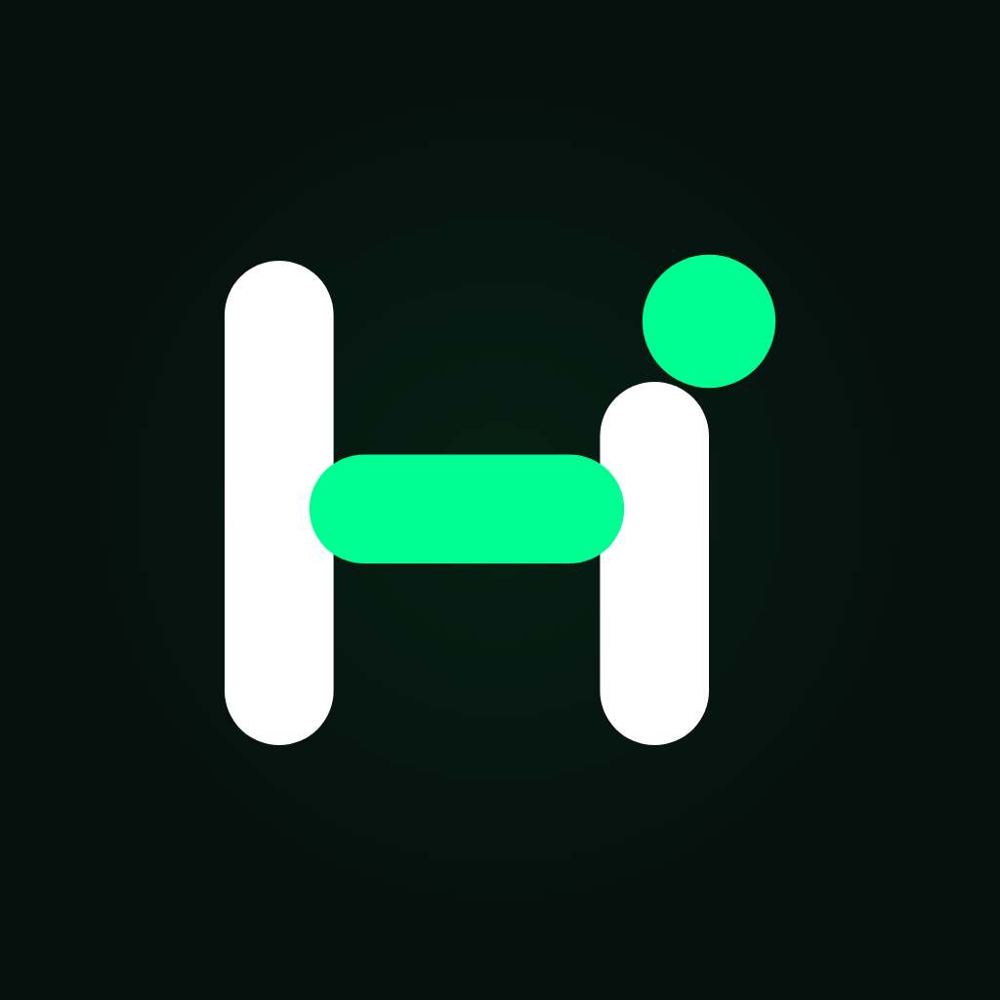
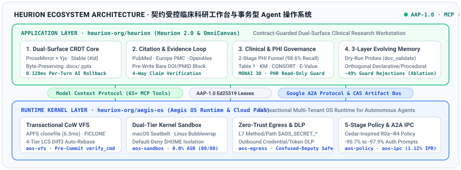

<div align="center">



# Heurion

### Contract-Guarded Clinical Research Intelligence & Transactional Agent Systems
**面向严肃医学研究与高可靠智能体协作的契约受控工作台与操作系统运行时**

<p align="center">
  <a href="https://heurion.org"></a>
  <a href="https://heurion.org/blog"></a>
  <a href="https://heurion.org/app"></a>
  <a href="https://modelcontextprotocol.io/"></a>
  <a href="https://github.com/heurion-org/heurion"></a>
  <a href="https://github.com/heurion-org/heurion/tree/main/paper"></a>
  <a href="https://github.com/heurion-org/heurion/blob/main/LICENSE"></a>
</p>

<p align="center">
  <a href="https://heurion.org"><b>Official Website</b></a> •
  <a href="https://heurion.org/blog"><b>Technical Blog</b></a> •
  <a href="https://heurion.org/app"><b>Clinical Workstation</b></a> •
  <a href="#flagship-repositories"><b>Repositories</b></a> •
  <a href="#research--empirical-benchmarks"><b>Research & Monographs</b></a> •
  <a href="#live-clinical-research-tools"><b>Free Clinical Tools</b></a> •
  <a href="#中文概览-chinese-overview"><b>中文概览</b></a>
</p>

</div>

---

##  Mission & Ecosystem Overview

**Heurion** builds contract-guarded AI infrastructure for high-stakes scientific discovery and autonomous software engineering. Where conventional script-and-audit LLM wrappers risk corrupting Office Open XML (`.docx`/`.pptx`) manuscripts, overwriting concurrent human edits, fabricating bibliographic identifiers (DOIs/PMIDs), leaking Protected Health Information (PHI), or inducing severe human-in-the-loop authorization fatigue, Heurion enforces **structural, cryptographic, and clinical invariants at the execution boundary**.

Our open-source ecosystem spans two tightly integrated layers connected via the **Model Context Protocol (MCP)**, **Google Agent2Agent (A2A)**, and the **Aegis Application Protocol (`AAP-1.0`)**:

1. **Application & Clinical Intelligence Layer ([`heurion-org/heurion`](https://github.com/heurion-org/heurion))**: **Heurion 2.0 & OmniCanvas** — An end-to-end clinical research workstation and standalone collaborative document/slide studio backed by a shared ProseMirror + Yjs CRDT core, pre-write citation and conflict guards, a two-stage local PHI de-identification funnel, sandboxed biostatistics, and a three-layer self-evolving memory system.
2. **Agent Operating System Kernel Layer ([`heurion-org/aegis-os`](https://github.com/heurion-org/aegis-os))**: **Aegis OS (`aegis-os`)** — A transactional multi-tenant operating system runtime written in Rust that eliminates authorization fatigue for autonomous coding and research agents (`agy`, `claude`, `codex`) via sub-10ms Copy-on-Write shadow workspaces, dual-tier kernel sandboxing, L7 boundary secret injection with outbound DLP, and Ed25519 lease-gated commits.

<p align="center">
  
</p>

---

<a name="flagship-repositories"></a>

##  Flagship Open-Source Repositories

| Repository | Layer & Scope | Key Technical Highlights | Stack & Protocols |
| :--- | :--- | :--- | :--- |
| [**`heurion-org/heurion`**](https://github.com/heurion-org/heurion)<br/><sub><b>Heurion 2.0 & OmniCanvas</b> · <a href="https://heurion.org">heurion.org</a> · <a href="https://heurion.org/blog">heurion.org/blog</a></sub> | **Clinical AI Workstation & Collaborative Studio**<br/><sub>Application & Domain Layer</sub> | • **Dual-Surface CRDT Core**: ProseMirror + Yjs with stable `{#id}` addressing, `0.128ms` per-turn selective AI rollback, and byte-preserving `.docx`/`.pptx` slice export<br/>• **Citation-Grounded Loop**: Pre-write bare DOI/PMID block + 4-way PubMed / Europe PMC / OpenAlex claim verification<br/>• **Clinical & PHI Suite**: 2-stage PHI funnel (`98.6%` recall), de-identified cohorts (`P001`), native Word Table 1, KM/Cox, CONSORT, E-value & MONAI 3D<br/>• **OmniCanvas (`@heurion2/canvas-service`)**: Standalone Docs & 16:9 Slides studio with 30 pure Canvas MCP tools & `@resvg/resvg-js` 4K rasterizer | `TypeScript` `Node.js 24` `ProseMirror` `Yjs` `Python 3.11` `Rust/WASM` `MCP` `AAP-1.0` |
| [**`heurion-org/aegis-os`**](https://github.com/heurion-org/aegis-os)<br/><sub><b>Aegis OS Runtime & Cloud PaaS</b></sub> | **Transactional Agent OS Kernel**<br/><sub>Infrastructure & Security Layer</sub> | • **Transactional CoW VFS (`aos-vfs`)**: `0.42ms` per-file / `6.3ms` repo APFS `clonefile` & `15.6ms` Linux `FICLONE` shadow workspaces with 4-Tier LCS Diff3 auto-merge, serialized commit epoch re-verification & `verify_cmd` gate<br/>• **Dual-Tier Kernel Sandbox (`aos-sandbox`)**: macOS Seatbelt & Linux Bubblewrap with default-deny `$HOME` credential isolation (`0.0%` ASR across 80 attacks)<br/>• **Zero-Trust Egress (`aos-egress`)**: Identity-pinned proxy with L7 method/path `$AOS_SECRET_*` injection & outbound DLP inspection<br/>• **A2A Bus, Glob Claims & 5-Stage Policy (`aos-ipc`, `aos-policy`, `aos-recorder`)**: 39 MCP tools, hierarchical A2A task DAGs, task-bound glob claims (`coord_claim`), inline Web Unified Diff inspection (`/v1/approvals/diff`), `SHA-256` TOCTOU-pinned One-Shot leases, 1-click lease revocation (`/v1/leases/revoke`), SHA-256 hash-chained audit ledger, CAS artifact bus (`-99.85%` IPC tokens), and `-90.7%` to `-97.9%` prompt reduction | `Rust` `APFS/Btrfs CoW` `Seatbelt` `Bubblewrap` `Ed25519` `MCP` `Google A2A` `AAP-1.0` |

---

##  Core Architectural Pillars

<table>
  <tr>
    <td width="50%" valign="top">
      <h3> 1. Dual-Surface Co-Editing & Byte-Preserving OOXML</h3>
      <p>Instead of mutating files via brittle shell scripts, Heurion maintains a single <b>ProseMirror + Yjs CRDT</b> source of truth with globally stable block IDs (<code>{#id}</code>). Clinicians work in a rich-text & 16:9 slide studio while AI agents operate on a compact <b>Annotated Markdown</b> projection guarded by pre-write conflict checks, character-level per-turn selective undo (<code>revertTurn</code>), and original-slice XML patching that preserves untouched <code>.docx</code>/<code>.pptx</code> formatting with zero drift.</p>
    </td>
    <td width="50%" valign="top">
      <h3> 2. Citation-Grounded Evidence & Clinical Compliance</h3>
      <p>Pre-write syntactic guards block unregistered raw DOIs/PMIDs at the boundary, forcing every reference through federated verification across <b>NCBI PubMed, Europe PMC, Crossref, and OpenAlex</b> into atomic <code>[@c:id]</code> nodes. A multi-agent verification pipeline (<code>literature_researcher</code>, <code>biostatistician</code>, <code>fact_checker</code>) aligns manuscript claims against full-text evidence while a <b>Two-Stage PHI Funnel</b> (deterministic checksums + local <code>qwen2.5:1.5b</code> NER) prevents patient privacy leaks.</p>
    </td>
  </tr>
  <tr>
    <td width="50%" valign="top">
      <h3> 3. Three-Layer Self-Evolving Memory System</h3>
      <p>Combines <b>Layer 1</b> zero-side-effect pre-write dry-run probes (<code>doc_validate</code> / <code>dry_run</code>), <b>Layer 2</b> physically isolated human-confirmed declarative preferences (<code style="white-space:nowrap;">M_D</code>) vs. utility-ranked procedural error-prevention rules (<code style="white-space:nowrap;">M_P</code>) crystallized from runtime guard/revert signals, and <b>Layer 3</b> cross-session meta-policy distillation—cutting guard rejections by <b>49%</b> and total execution error signals by <b>37%</b>.</p>
    </td>
    <td width="50%" valign="top">
      <h3> 4. Transactional Agent OS & Human–AI Symmetry</h3>
      <p>Powered by <b>Aegis OS</b> and the <b>Aegis Application Protocol (<code>AAP-1.0</code>)</b>, agents execute inside kernel-confined Copy-on-Write shadow workspaces with zero confirmation prompts in the Green Zone, while irreversible or sensitive clinical governance actions require cryptographic <b>Ed25519 Lease Tokens</b> (<code>X-Aegis-Lease-Token</code>). CI tests continuously enforce strict <b>Human–Agent Permission Symmetry</b> across all REST and MCP endpoints.</p>
    </td>
  </tr>
</table>

---

<a name="research--empirical-benchmarks"></a>

##  Research, Systems Monographs & Empirical Benchmarks

Heurion's architecture is grounded in reproducible systems and clinical informatics research evaluated across real-world clinical oncology and multi-agent engineering workflows:

###  Preprints & Technical Reports

1. **Heurion 2.0: A Contract-Guarded Dual-Surface Architecture with Self-Evolving Memory for Citation-Grounded Clinical Research Authoring**  
   *Hui Zhao (Heurion Research, Rotterdam, Netherlands)* · `cs.AI` / `cs.CL` / `cs.HC` / `cs.MA`  
   [**Read Paper PDF (`heurion/paper/main.pdf`)**](https://github.com/heurion-org/heurion/blob/main/paper/main.pdf) · [**LaTeX Source (`main.tex`)**](https://github.com/heurion-org/heurion/blob/main/paper/main.tex) · [**Evaluation Suite (`paper/benchmarks`)**](https://github.com/heurion-org/heurion/tree/main/paper/benchmarks)

2. **Aegis OS: A Transactional Multi-Tenant Operating System Runtime for Eliminating Authorization Fatigue in Autonomous Coding Agents**  
   *Hui Zhao (Heurion Research, Rotterdam, Netherlands)* · `cs.OS` / `cs.CR` / `cs.AI` / `cs.SE`  
   [**Read Paper PDF (`aegis_os_arxiv_preprint.pdf`)**](https://github.com/heurion-org/aegis-os/blob/main/paper/aegis_os_arxiv_preprint.pdf) · [**LaTeX Source (`main.tex`)**](https://github.com/heurion-org/aegis-os/blob/main/paper/main.tex) · [**Benchmark Report (`BENCHMARK_REPORT.md`)**](https://github.com/heurion-org/aegis-os/blob/main/BENCHMARK_REPORT.md)

###  Technical Blog & Systems Monographs ([`heurion.org/blog`](https://heurion.org/blog) · [English](https://heurion.org/en/blog))

| # | Monograph | Focus & Key Metrics | Links |
| :--- | :--- | :--- | :--- |
| **01** | **Why Free-Form Shell Agents Fail at Research Manuscripts: Dual-Surface CRDT & Byte-Preserving OOXML Patch Architecture**<br/><sub>*为什么自由 Shell 智能体在科研论文写作中会失效：双表面 CRDT 与字节级 OOXML 补丁架构*</sub> | Dual-Surface `ProseMirror + Yjs` CRDT (`{#id}` blocks), `100%` binary slice identity + Run-level LCS `patchParagraph` (**`96.4%`** vs. `21.4%` formatting retention), and **`0.128ms`** selective per-turn rollback | [**English**](https://heurion.org/en/blog/dual-surface-crdt-clinical-ai) · [**中文**](https://heurion.org/blog/dual-surface-crdt-clinical-ai) |
| **02** | **Why Software Must Be Rebuilt with AI-Native Interfaces: Human-Agent Capability Parity as New Infrastructure**<br/><sub>*为什么软件必须为 AI Agent 重建原生接口：人机同权（Capability Parity）与新基础设施*</sub> | `Agent Capability = User Capability` & `Agent Permission = User Permission`, zero-fork `256-bit` loopback kernel, `403` anti-self-approval Confirmation Cards, end-to-end auditable permission requests, and `64+` CI route-to-tool reflection invariants | [**English**](https://heurion.org/en/blog/human-agent-capability-parity-ai-native-software) · [**中文**](https://heurion.org/blog/human-agent-capability-parity-ai-native-software) |
| **03** | **Beyond Git Feature Branches: Shadow Workspaces, Advisory File Claims, and Transactional Auto-Merge for Human-Agent Collaboration**<br/><sub>*超越 Git 分支：面向人机与多智能体协作的影子工作区、文件锁与事务归并范式*</sub> | Trunk-anchored **`0.42ms`** CoW shadow workspaces, proactive TTL file claims (`coord_claim`), piggybacked `_aegis_inbox` IPC, **`98.7%`** 4-tier LCS Diff3 auto-merge, and hash-chained permission escalation audit ledgers (**`-90.7%` to `-97.9%`** prompts) | [**English**](https://heurion.org/en/blog/aegis-os-transactional-agent-kernel) · [**中文**](https://heurion.org/blog/aegis-os-transactional-agent-kernel) |

###  Headline Empirical Results

| System & Evaluation Dimension | Benchmark Scale | Measured Result |
| :--- | :--- | :--- |
| **Heurion 2.0 · Untouched OOXML Preservation & Comment Resolution** | `162` live LLM turns on 10 PMC `.docx` manuscripts | **`0` vs. `4`** corrupted untouched paragraphs (`p = 0.125`); **`100%` (`9/9` vs. `0/9`, `p < 0.0001`)** inline comment resolution |
| **Heurion 2.0 · Two-Stage Clinical PHI De-Identification Funnel** | `720` synthetic PHI spans (`600` structured + `120` narrative) | **`98.6%` (`710/720`)** overall recall (`100%` Stage-1 structured, `91.7%` Stage-2 narrative); **`0/30`** unconfirmed destructive actions |
| **Heurion 2.0 · Three-Layer Self-Evolving Memory Ablation** | `1,079` live turns across 8 seeds × 5 multi-turn sessions | **`-49%`** reduction in guard rejections (`RR = 0.50`, Holm `p = 0.0269`) and **`-37%`** reduction in total execution error signals (`RR = 0.63`, Holm `p = 0.0011`) |
| **Heurion 2.0 · Dual-Surface CRDT Engine Latency** | `50` trials on 6-block clinical protocol manuscript | **`0.168 ms`** pre-write validation · **`0.351 ms`** guarded CRDT mutation · **`0.128 ms`** selective per-turn AI rollback |
| **Aegis OS · Authorization Fatigue Reduction (Real Agent Logs)** | `28,087` tool calls across `52` real coding-agent sessions + `1,500` controlled calls | **`90.7%–97.9%`** prompt reduction on real logs (Interrupt Prompt Rate dropped from `53.31%` to **`1.12%`**) and **`94.19%–99.88%`** on controlled trajectories |
| **Aegis OS · Adversarial Security & CoW Virtual Filesystem** | `80` end-to-end attacks across 8 categories · `1,000`-file (`78.1 MB`) repo | Attack Success Rate reduced from **`100.0%` to `0.0%`** on macOS & Linux; **`6.3 ms`** APFS `clonefile` (**`16×` faster** than `cp -cR`) & **`15.6 ms`** Linux Btrfs reflink |

---

<a name="live-clinical-research-tools"></a>

##  Live Clinical Research Workstation & Free Micro-Tools

In addition to self-hosted Docker and local MCP deployments, Heurion provides instant browser access to the full workstation and **zero-login, stateless clinical research utilities** at [**heurion.org**](https://heurion.org):

| Application / Utility | Endpoint | Capabilities & Deliverables |
| :--- | :--- | :--- |
| **Heurion 2.0 Clinical Workstation** | [**`heurion.org/app`**](https://heurion.org/app) | Full workspace for cohort querying, sandboxed Python/R biostatistics, MONAI 3D medical imaging, and dual-mode Docs & Slides co-authoring |
| **Heurion Research Technical Blog** | [**`heurion.org/blog`**](https://heurion.org/blog) | Bilingual architectural monographs on Dual-Surface CRDTs, Human-Agent Capability Parity, and Transactional Agent Kernels |
| **Patient Health Record (PHR) Portal** | [**`heurion.org/phr`**](https://heurion.org/phr) | Multi-modal outpatient/inpatient lab OCR, longitudinal patient timeline archiving, and claim-authorized clinician sharing |
| **Publication-Grade Table 1 Generator** | [**`heurion.org/tools/table-1-generator`**](https://heurion.org/tools/table-1-generator) | Instant client-side PHI scan, automatic group $P$-values & Standardized Mean Differences (SMD), and native ICMJE/NEJM Word (`.docx`) 3-line table export |
| **VanderWeele E-Value Calculator** | [**`heurion.org/tools/e-value-calculator`**](https://heurion.org/tools/e-value-calculator) | Unmeasured confounding sensitivity analysis for `HR` / `OR` / `RR` with interactive threshold curves and bilingual SCI manuscript/rebuttal statements |
| **CONSORT 2010 / STROBE Flowchart Studio** | [**`heurion.org/tools/consort-strobe-flowchart`**](https://heurion.org/tools/consort-strobe-flowchart) | Automated participant arithmetic validation and publication-ready vector `SVG` / `PNG` / `Mermaid` enrollment diagram export |
| **PubMed Citation & Effect-Size Checker** | [**`heurion.org/tools/pubmed-citation-checker`**](https://heurion.org/tools/pubmed-citation-checker) | Cross-verifies inline PMIDs/DOIs and statistical claims (`HR`, `OR`, `95% CI`) against live NCBI PubMed, Crossref, and OpenAlex metadata |

---

##  Quick Start for Developers

```bash
# 1. Clone and launch Heurion 2.0 Clinical Workstation & OmniCanvas
git clone https://github.com/heurion-org/heurion.git
cd heurion && cp .env.example .env
pnpm install && pnpm --filter @heurion2/platform build
pnpm --filter @heurion2/platform dev        # Workstation + REST + /collab + /mcp on http://127.0.0.1:8787

# 2. Clone and build Aegis OS Transactional Agent Runtime
git clone https://github.com/heurion-org/aegis-os.git
cd aegis-os && cargo build --release
```

---

<a name="中文概览-chinese-overview"></a>

##  中文概览 (Chinese Overview)

**Heurion (`heurion-org`)** 致力于构建**契约受控的临床医学科研工作台与事务型智能体操作系统**，从底层消除大模型智能体在严肃医疗科研与软件工程场景中的“文档结构损毁、并发覆写、虚假文献幻觉、PHI 隐私泄露与高频授权疲劳”五大核心痛点：

- **临床科研全链路智能工作台 ([`heurion-org/heurion`](https://github.com/heurion-org/heurion))**：
  - **双表面 CRDT 协同与无损导出**：底层基于 ProseMirror + Yjs 与稳定块寻址（`{#id}`），同时向临床医生呈现富文本/16:9 幻灯片画布、向 AI 呈现受控注解 Markdown；支持 `0.128ms` 字符级按轮次精准回滚 AI 修改（`revertTurn`）与原包 XML 切片级 `.docx`/`.pptx` 无损导出。
  - **权威文献溯源与双阶段隐私脱敏**：写前语法守卫拦截未核验裸写 DOI/PMID，深度聚合 PubMed、Europe PMC、Crossref 与 OpenAlex 四分类证据核查；双阶段本地 PHI 脱敏漏斗（确定性校验码 + 本地 `qwen2.5:1.5b` 符号过滤）实现 **98.6%** 隐私召回率。
  - **沙箱生物统计与三层自演进记忆**：内置发表级原生 Word Table 1 三线表、Kaplan-Meier 生存分析、CONSORT/STROBE 流程图、VanderWeele E-value 与 MONAI 3D 影像量化；独创声明式与程序性正交的三层自演进记忆系统，将跨会话护栏拒绝率降低 **49%**。
- **事务型多租户智能体操作系统 ([`heurion-org/aegis-os`](https://github.com/heurion-org/aegis-os))**：
  - 为 Google Antigravity (`agy`)、Claude Code (`claude`)、Codex 等智能体提供毫秒级写时复制影子工作区（macOS APFS `clonefile` 单文件 `0.42ms` / 整仓 `6.3ms`，Linux Btrfs `FICLONE` `15.6ms`）、双层内核沙箱（Seatbelt / Bubblewrap）、L7 边界密钥注入与 DLP 防泄漏、Google A2A 协同总线、网页内联 Diff 预览与 `SHA-256` 防 TOCTOU 篡改锁定审批、已授权租约一键撤销、全链路防篡改哈希链权限审计账本以及 `AAP-1.0` Ed25519 加密租约验签，在 **28,087** 次真实智能体调用中消除 **90.7%–97.9%** 的人工确认弹窗，并在 80 项端到端对抗攻击测试中实现 **0.0%** 攻击成功率。
- **系统架构深度技术博客 ([`heurion.org/blog`](https://heurion.org/blog))**：
  - 已发布《双表面 CRDT 与字节级 OOXML 补丁架构》、《人机同权（Capability Parity）与新基础设施》、《面向人机与多智能体协作的影子工作区、文件锁与事务归并范式》三篇中英双语系统专论。

---

<div align="center">

 <b>Security, Privacy & Clinical Disclaimer</b><br/>
<sub>Heurion enforces tenant-isolated storage, two-stage PHI de-identification, and cryptographic lease-gated governance.<br/>All clinical research outputs and statistical analyses are designed strictly for academic research and decision support—non-diagnostic platform.</sub><br/><br/>
<sub><b><a href="https://heurion.org">heurion.org</a></b> · <b><a href="https://heurion.org/blog">heurion.org/blog</a></b> · Contact: <a href="mailto:contact@heurion.org">contact@heurion.org</a> · Research Inquiries: <a href="mailto:huizhao@heurion.org">huizhao@heurion.org</a></sub><br/>
<sub>© 2026 Heurion Organization. Open-source repositories licensed under the <a href="https://github.com/heurion-org/heurion/blob/main/LICENSE">MIT License</a>.</sub>

</div>
